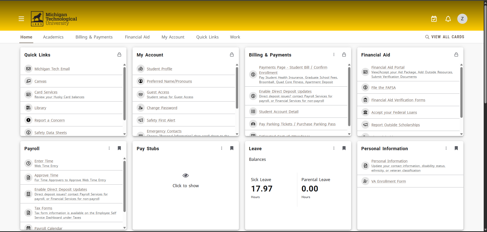
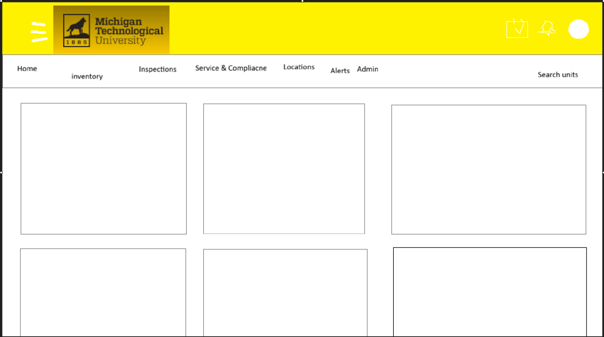

# Fire Extinguisher Prototype

For this prototype dashboard, I took **heavy** inspiration from the MTU experience.elluciancloud site.

I also made sure to include 5 sample test data points using the schema data dictionary. These will need to be changed when we start doing SQL work.

Attached is the rough plan for the dashboard. Should work. Will probably vibecode a base.
